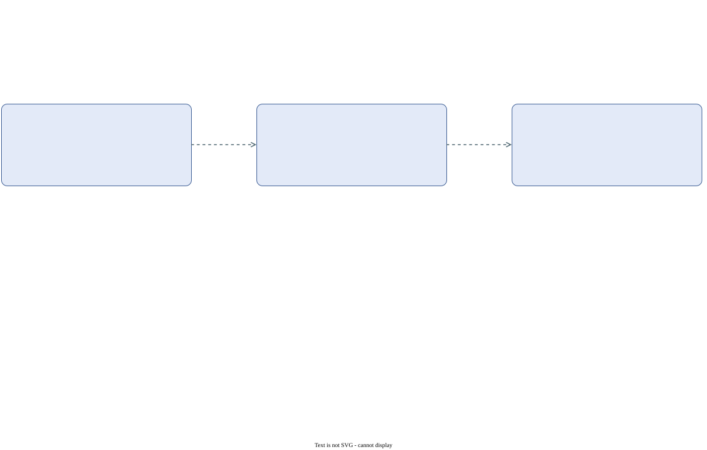
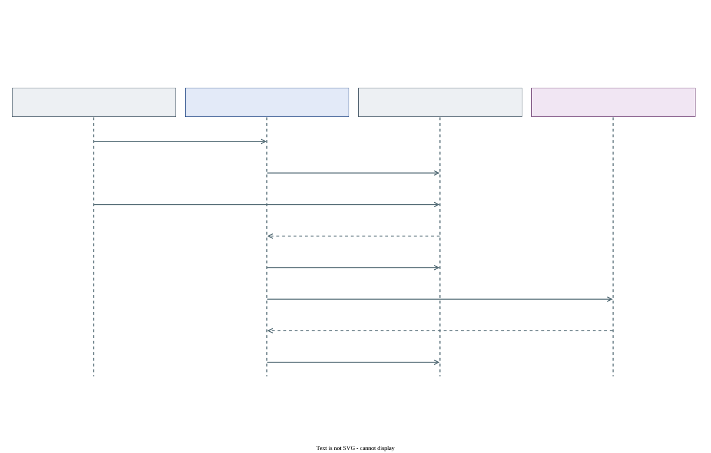
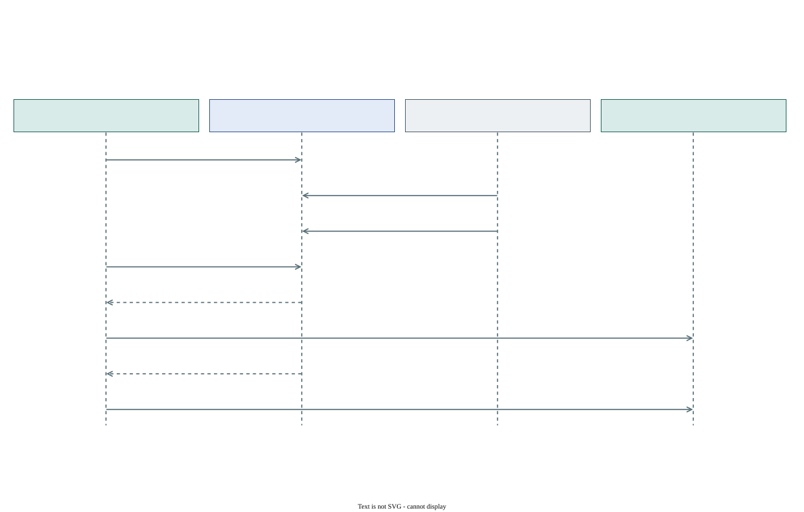

These diagrams show Garden's moving parts in one picture each. Each diagram lives in `docs/diagrams/` as a `.drawio.svg` file, so it renders on GitHub and here and still opens in draw.io. The date line on each diagram names the Garden commit it was last checked against.

## Components

This diagram answers which services, workflows, and Durable Objects handle a member's request, and where authority is checked. Read [agent runtime](./agent-runtime.md) and [how Garden is built](./how-garden-is-built.mdx) for the detail.

## Deployment and storage

This diagram answers where Garden's code runs and which store holds each kind of state. The bindings it names come from `apps/web/wrangler.jsonc`. Read [how Garden is built](./how-garden-is-built.mdx) for the full list.

## Issue run and retained context

This diagram answers how a run keeps its submission and Brain history safe across retries and resumes. Read [run engine](./run-engine.md) and [issues](../features/issues.md) for the run lifecycle.

## Member connector access

This diagram answers how one member connects WorkStream through OAuth without touching another member's connection. Read [connectors](./connectors.md) and [WorkStream](../features/workstream.md).

## Host launch protocol

This diagram answers why a launch receipt alone cannot start a worker on an execution host. The Garden receiver it shows is still under review and is not on `dev`. Read [execution runtimes](./execution-runtimes.md) and the [execution host contract](../../proposals/execution-host-contract.md).

## Host intervention and recovery

This diagram answers how a host applies a person's answer exactly once and recovers when it is unsure a process stopped. Like the launch protocol, its Garden side is still on review branches. Read the [execution host contract](../../proposals/execution-host-contract.md).

## Edit a diagram

1. Open the `.drawio.svg` file in draw.io desktop, app.diagrams.net, or the VS Code Draw.io Integration extension. An agent can instead edit the draw.io XML embedded in the file and run `pnpm diagrams:export` to redraw the picture.
2. Make the change, update the "checked against" commit on the date line, and save. Keep the file name and the `.drawio.svg` extension.
3. Run `pnpm verify:diagrams`, then commit the file in the same pull request as the code change.

`docs/diagrams/manifest.json` maps each diagram to the code paths it describes. A pull request that changes one of those paths must update the diagram or say why it still holds. See [Pull request contract](../../reference/pr-contract.mdx).
