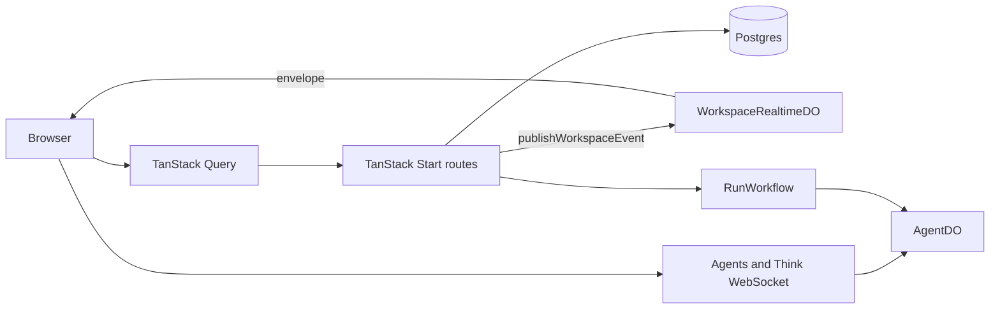

Garden has three kinds of live behavior, and each has its own channel:

1. Durable product data lives in Postgres. The browser reads it through TanStack Query.
2. AI and chat output streams over Agents and Think WebSocket connections.
3. Workspace changes, such as an issue edit, fan out through one realtime hub per workspace.

Keeping the three apart is the main design choice. Chat traffic never rides the workspace hub, and the hub never becomes a second database.

## Each layer owns one thing

The table lists what each layer owns.

| Layer | Owns |
| --- | --- |
| Postgres | Durable records: workspaces, agents, chat thread metadata, issues, runs, automations, connectors, documents, and audit |
| TanStack Start routes and server services | Auth checks, CRUD, run start and cancel, and query responses |
| TanStack Query | The browser cache, refetch, and polling |
| `AgentDO` and its Think facets | Agent identity, chat streams, and live run turns |
| `RunWorkflow` | Durable retry, wait, resume, and cancel between Think turns |
| `WorkspaceRealtimeDO` | Live workspace sockets and event fan-out |

## Chat streams on its own socket

`apps/web/src/features/chat/chat-runtime-provider.tsx` opens the chat WebSocket through `useAgent` and `useAgentChat` for the mounted chat panel. That socket carries Think messages for one `ChatSubAgent`. See [agent runtime](./agent-runtime.md).

Issue run progress does not use the hub yet. `apps/web/src/lib/issues/queries.ts` polls the active run and its events every 2 seconds while a run is active.

## The workspace hub signals, clients refetch

`WorkspaceRealtimeDO` in `packages/agent-runtime/src/workspace-realtime-do.ts` is one Durable Object per workspace, bound as `WORKSPACE_REALTIME` in `apps/web/wrangler.jsonc`. It holds hibernating WebSockets.

The pieces fit together like this:

| Piece | Where |
| --- | --- |
| Hub | `packages/agent-runtime/src/workspace-realtime-do.ts` |
| Audience rules, as pure functions | `packages/agent-runtime/src/realtime-audience.ts` |
| Connect route `/api/realtime`, with session and membership auth | `apps/web/src/lib/server/realtime.ts`, wired in `apps/web/src/server.ts` |
| Publish helper `publishWorkspaceEvent` | `apps/web/src/lib/server/realtime.ts` |
| Client channel | `apps/web/src/lib/realtime/realtime-manager.ts` |
| Event contract | `RealtimeEventEnvelope` and `RealtimePublishableEvent` in `packages/core/src/types/events.ts` |

A write follows these steps:

1. The route authenticates and authorizes the request.
2. The route writes to Postgres.
3. The route calls `publishWorkspaceEvent`, which sends an envelope to the hub. The envelope has `event_id`, `type`, `workspace_id`, `published_at`, and `payload`.
4. The hub applies audience rules per connection and sends the envelope only to eligible sockets.
5. The client invalidates TanStack Query roots such as `['teams', workspaceId]` and `['issues', workspaceId]`.
6. The client refetches through the normal access-checked APIs.

Clients never render the payload. That keeps the hub out of the business of deciding what a user may see. The access-checked API decides that on every refetch.

The hub publishes team, team member, issue, and comment events today. The routes that publish are the Teams routes under `apps/web/src/routes/api/teams/`, `apps/web/src/routes/api/issues.ts`, `apps/web/src/routes/api/issues/$id.ts`, and the comment routes. Inbox and run events can use the same hub once they are wired.

## Audience rules decide who hears what

`canReceiveRealtimeEvent` in `realtime-audience.ts` applies these rules:

- Workspace owners and admins receive every event.
- `team:*` and `team_member:*` events reach members of that Team.
- An `issue:*` event with a `team_id` reaches the Team owner, and reaches a member only when the issue is assigned to them.
- An `issue:*` event without a `team_id` reaches every workspace member.

Team event payloads carry identifiers only, never a Team DTO or Team name, because the publisher's `can_manage` flag and visible counts would leak to every recipient. See [Teams](../features/teams.md#realtime-events-say-what-changed-not-what-it-looks-like).

Each connection keeps a profile of its Teams. Team events refresh that profile, so a long-lived socket stays correct without a database read on every delivery.

## Reconnects and latency are measured

The client reconnects with capped exponential backoff. After a reconnect it invalidates the Teams and issues roots so the open view refetches. An unauthorized close (code 1008, 4001, or 4003) stops the loop until the session changes.

Three signals carry the event id and measure the path from publish to cache update:

- The route logs `realtime.published`.
- The hub logs `realtime.delivered` with `publishToDeliverMs`.
- The client sends `realtime_event_applied` to PostHog with `publish_to_invalidate_ms`.

The target is a p95 below 500 ms from publish to cache update.

## Not built

The hub does not carry presence or cache patches. An earlier design proposed `presence.update` and `entity.patch` events. Neither exists. Add them only when a product surface needs them.

## Constraints

These rules keep the channels apart:

- App-wide realtime does not share the AI chat transport.
- The hub does not store business data.
- Skill assignment and prompt changes use explicit write-path signals or versioning, not client-side polling of the database.
