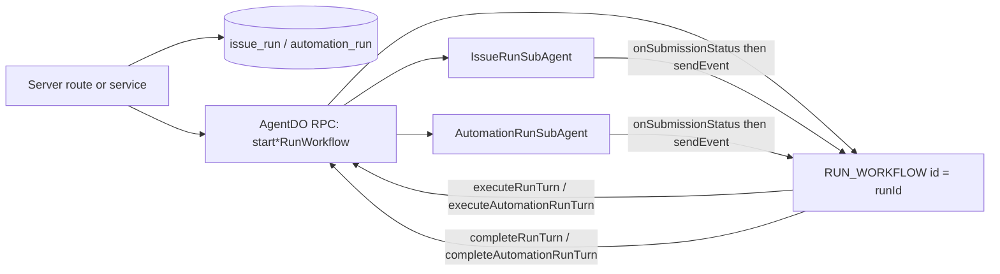

Garden runs two product surfaces, issues and automations, through one durable executor. The engine turns an `issue_run` or `automation_run` row into a Think agent loop that survives Durable Object eviction, waits for people, and stops when cancelled.

## Three pieces, two owners

The engine has three parts:

- **Think** (`@cloudflare/think`) is the agent loop. It owns messages, tool calls, streaming, and a durable submission ledger: `submitMessages()`, `inspectSubmission()`, `onSubmissionStatus()`, and `cancelSubmission()`.
- **`RunWorkflow`** in `packages/agent-runtime/src/run-workflow.ts` extends `AgentWorkflow` from `agents/workflows`. There is one Workflow instance per run, and the instance id is the run id.
- **`AgentDO`** in `packages/agent-runtime/src/agent-do.ts` is the parent Durable Object. It hosts one Think facet per run (`IssueRunSubAgent` or `AutomationRunSubAgent`) and exposes the RPC methods the Workflow calls.

The Workflow owns durability: retries, durable waits, resume, cancel, and terminal bookkeeping. The facet owns live state: tools, MCP connections, and streaming. Neither owns both. That split is the main design choice, and every rule on this page protects it.

Run rows start in `startIssueRun` (`packages/server/src/issues/run-service.ts`) and `startAutomationRun` (`packages/server/src/automations/run-service.ts`). For the full code map, see the [architecture map](../../reference/architecture-map.md).



## A run, turn by turn

A run moves through these steps:

1. **Start.** A server service inserts the run row, then calls `AgentDO.startIssueRunWorkflow` or `AgentDO.startAutomationRunWorkflow`.
2. **Create the Workflow.** The DO calls `this.runWorkflow('RUN_WORKFLOW', ...)` with the run id as the instance id. The instance id is the idempotency boundary. A duplicate create counts as success.
3. **Submit a turn.** `RunWorkflow.run()` loops up to `MAX_TURNS` (200). Each turn runs a `step.do` with `TURN_RETRIES` (3 tries, 5 second exponential backoff). The step calls `AgentDO.executeRunTurn` or `executeAutomationRunTurn`, which calls the facet.
4. **Hand the turn to Think.** The facet calls `this.submitMessages([message], ...)` with the submission id as the idempotency key and the run id in metadata. It returns at once instead of blocking until the turn ends.
5. **Wait durably.** If the submission is not already terminal, the Workflow calls `step.waitForEvent` on the event type `run-turn-complete:<submissionId>`. No timer or in-memory waiter exists in the DO.
6. **Wake.** When a submission ends, Think calls the facet's `onSubmissionStatus` override. The facet reads the run id from metadata and sends the event to the Workflow instance.
7. **Close the turn.** The Workflow calls `AgentDO.completeRunTurn` or `completeAutomationRunTurn`. The facet inspects the submission and writes the product status. An `error` or `skipped` submission fails the run. An `aborted` submission cancels the run if cancel was requested and fails it otherwise.
8. **Branch on the status.** A terminal status (`succeeded`, `completed`, `failed`, `cancelled`, `blocked`, or `skipped`) ends the Workflow. An awaiting status (`waiting_for_input` or `waiting_for_approval`) makes the Workflow wait for a `run-control` event. An automation turn that returns `waitingOn: { kind: "decide_analysis", decideRunId }` makes the Workflow wait for `decide-analysis-finished:<decideRunId>`, bounded by `DECIDE_ANALYSIS_OWNER_WAIT_MS`, then run the next turn in resume mode. See [Decide](../features/decide.md#in-an-automation-the-run-pauses-and-resumes). Any other status ends the Workflow as is.
9. **Hit the cap.** After 200 turns with no end, the Workflow reports `max_turns_exceeded`.

## Two ledgers share one engine

The two surfaces keep separate ledgers and status words:

| Surface | Ledger | Statuses | Pauses for people |
| --- | --- | --- | --- |
| Issues | `issue_run` | `queued`, `running`, `waiting_for_input`, `waiting_for_approval`, `succeeded`, `failed`, `cancelled`, `blocked` | Yes. A run can pause on a question, `mark_blocked`, or an approval gate. |
| Automations | `automation_run` | `pending`, `queued`, `running`, `completed`, `failed`, `cancelled`, `skipped` | Not for people. A run can pause while a Decide analysis it started runs, and resumes when Decide finishes. |

`TERMINAL_RUN_STATUSES` and `AWAITING_RUN_STATUSES` in `run-workflow.ts` are the union of both ledgers. One generic loop is simpler, but it means the Workflow does not check which statuses fit which run kind. Database check constraints and each facet's `completeWorkflowTurn` enforce that.

An automation run never creates an issue, never appears on the kanban, and never routes through `issue_run`. If an automation's task needs to touch issues, the automation does that through its own tools.

## Resume and cancel are Workflow events

Both controls go to the Workflow instance keyed by the run id:

```ts
const instance = await env.RUN_WORKFLOW.get(runId)
await instance.sendEvent({
	type: 'run-control',
	payload: { kind: 'resume' },
})
```

A `resume` payload starts the next turn in resume mode. A `cancel` payload, or a wait that ends with no event, runs the cancel branch. `AgentDO.cancelIssueRun` and `AgentDO.cancelAutomationRun` also call `abortSubAgent` so that in-flight model and tool work stops at once instead of at the next Workflow step.

## Schedules start runs but are not the engine

`AutomationTriggerDO` in `packages/agent-runtime/src/automation-trigger-do.ts` owns schedule state. It computes the next fire time from the cron expression and time zone, and it sets a one-time Agents SDK schedule. When the schedule fires, it applies the automation's concurrency policy, inserts the `automation_run` row, and calls `AgentDO.startAutomationRunWorkflow`.

Two policies work: `skip` and `replace`. The schema also lists `queue`, but `parseConcurrencyPolicy` rejects it as not implemented. Manual, webhook, and API runs skip this DO and join the same path at the `automation_run` row.

## Why Garden dropped its own waiters

Before Think had durable submissions, the DO waited in-process for a turn to finish, with timers and an in-memory callback map. Long tool calls could outlast that window while Think was still working. The current model removes that layer. Think's submission ledger decides whether a turn is done, `onSubmissionStatus` is the only wake path, and `waitForEvent` is the only wait. If a second recovery layer looks necessary, the cause is likely a gap in Think or Workflows that should be named and linked, not worked around.

## Pick the primitive by the job

Cloudflare offers several durable primitives. Garden uses each for one shape of job and does not merge them into one abstraction.

- **Workflows for product runs.** Issue and automation runs have run ids, database status, audit events, user-visible cancel, and durable waits on Think submissions. That is the job Workflows does.
- **Managed fibers for agent-local background work.** Work that belongs to one agent, must survive eviction, and is not a product run fits the Agents SDK fiber API: `startFiber`, `runFiber`, `inspectFiber`, `listFibers`, `cancelFiber`, `FiberContext.signal`, and `stash()`. Candidates include connector capability refreshes, cache builds, sandbox cleanup, and agent maintenance. Garden does not use fibers yet.
- **Sandbox preview tunnels for live previews only.** A sandbox quick tunnel shows a generated web artifact while the sandbox runs. It is not storage. Garden stores accepted artifacts separately.

Do not move issue or automation runs to fibers unless Workflows cannot meet a proven requirement.

## Design rules

These rules keep the split between Workflow and facet intact:

- Do not add a queue, dispatcher, or queue consumer between `AgentDO` and `RunWorkflow`. The run id as instance id is the idempotency boundary.
- Do not monkey-patch SDK lifecycle methods. Do not take a method off `this` and call it loose, because that drops the `this` binding.
- Do not rebuild a DO-local waiter or timeout. Use `submitMessages()`, `onSubmissionStatus()`, and `waitForEvent()`.
- Do not route automations through `issue_run` or model them as issues.
- If Workflow creation fails, fail that run's start in the ledger. Do not hide the failure behind a reconciler unless a linked Cloudflare platform gap requires one.
- Keep issue-run code and automation code separate. Share only product-neutral parts: `RunWorkflow`, model and tool setup, and MCP controller patterns.

Open work on the engine, such as the staging lifecycle proof and the `queue` policy, is tracked in [known gaps](../../reference/known-gaps.md).
