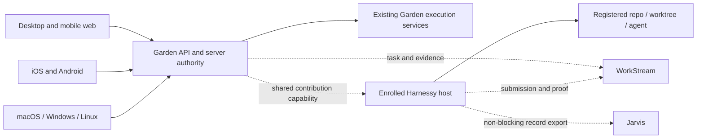
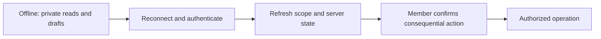

Garden needs desktop web, mobile web, native iOS and Android clients, and a native desktop release for macOS, Windows and Linux together. This page records the scope agreed on 2026-11-10 and the proposed technical sequence.

**Current status:** Garden has a web application. This change adds no native application, API endpoint, plugin installer or execution-host transport. Frameworks, minimum OS versions, Linux distributions, dates and budgets remain open. The [roadmap](../concepts/product/roadmap.md) keeps the dependable-beta release gates.

## Scope and independent choices

The first mobile release covers workspace chat, tasks, approvals, launch and run status. Desktop can reuse the web interface inside a native application if it supplies proper native integration. First offline behavior is private cached reading and drafts. Consequential actions require reconnection and current authority.

| Choice | Meaning |
| --- | --- |
| Client surface | Where the member views work: web, iOS, Android or desktop application. |
| Execution host | The enrolled machine or service that owns repository mappings, credentials and agent processes. |
| Execution runtime | The compatible isolated environment that executes a capability. |
| User configuration | Language, model, knowledge provider, agent, budget and authorized host. |

A native mobile client is not an on-device coding-agent host. Native desktop does not grant local shell access by default. Garden's existing managed execution services remain valid hosts for their supported operations.

## Current boundary map

The inspected baseline is Garden dev commit `9d8b96fc`, checked on 2026-11-10. These are source observations, not deployment or device tests.

| Boundary | Current implementation | Reuse or gap |
| --- | --- | --- |
| Typed HTTP contract | `apps/web/src/lib/api/garden-api-contract.ts` composes the skills and document-artifact groups. | Extend the existing contract pattern only for operations the client needs. It does not yet describe the whole product. |
| Other product APIs | `apps/web/src/lib/api/issues.ts` uses the shared transport; issue routes live under `apps/web/src/routes/api/issues/`. | Inventory the selected task/read/status operations before moving modules. Garden issues and WorkStream tasks have different authorities. |
| HTTP transport | `apps/web/src/lib/api/transport.ts` supplies workspace/request headers and cookie credentials. Upload progress uses XMLHttpRequest. | Allow explicit origin and platform session/transport adapters. A request correlation ID is not a durable idempotency guarantee. |
| Authentication client | `apps/web/src/lib/auth/client.ts` derives its origin from the browser and imports Better Auth's React client. | Define native sign-in and callback/session handling. Do not infer native support from browser-cookie behavior. |
| Server session and authority | `apps/web/src/lib/server/context.ts`, `apps/web/src/lib/server/control-plane.ts` and `apps/web/src/lib/server/workspace-permissions.ts` own request context, membership and operation checks. | Preserve server checks. Explicit workspace selection must not silently select another workspace when membership changes. Qualify native authentication separately. |
| Chat | `apps/web/src/features/chat/chat-runtime-provider.tsx` uses React, Agents and Think WebSocket hooks. Agent entry authorization is in `apps/web/src/server.ts`. | Keep conversation identity and the existing server owner. Verify mobile transport/lifecycle support before selecting a client integration. |
| Workspace events | `apps/web/src/lib/server/realtime.ts` authorizes workspace sockets; `packages/core/src/types/events.ts` defines events. | Reuse identifiers and invalidation semantics. Reconnect must refetch authorized state; events do not grant access. |
| Approval | `apps/web/src/routes/api/chat/threads/$id/tool-approval.ts` resolves chat tool approvals. | Render native controls against the same server-side authority and current request. Notification receipt is not approval. |
| Cancellation | `apps/web/src/routes/api/issues/$id/cancel.ts` checks access and issue-management permission before calling the run service. | Keep cancellation separate from client disconnection. This existing issue-run route does not implement remote Harnessy cancellation. |
| Recovery | `packages/agent-runtime/src/run-workflow.ts` owns durable issue/automation execution. | Reuse the existing Workflow boundary. New external-host transport needs explicit reconciliation without a second agent or duplicate recovery loop. |

Read [HTTP API](../concepts/architecture/http-api.md), [realtime](../concepts/architecture/realtime.md), [run engine](../concepts/architecture/run-engine.md) and [known gaps](../reference/known-gaps.md) for their current contracts.

## Proposed client and host boundary

Dashed links describe required shared-capability work, not implemented integrations.

The Harnessy core enforces authority, installation and validated dispatch. Capability packages supply bounded operations and declared forms, actions and status cards. Hosts supply storage, credentials, networking and process services under explicit grants. Garden owns workspace controls and user interaction. WorkStream owns task, submission, evaluation and acceptance truth. Jarvis exports the agreed record; export failure must not block payment.

The first shared contribution journey must support an outside executable package and direct Garden-to-host launch. A copied CLI command is insufficient. Executable discovery and invocation require isolation; ordinary in-process loading is insufficient. Client work does not replace those delivery gates or make them prerequisites for the existing first-payment work.

## Smallest portable interface

Keep one existing server path. Do not create a second backend or a generic platform layer in this documentation change.

Share operation schemas, typed domain outcomes, durable identifiers, preference models and declared UI schemas. Keep shared contracts free of React, Node services and Cloudflare bindings. Keep the Worker composition and secret-bearing host services on the server.

The first implementation slice should:

1. Exercise one existing typed read operation through an explicitly configured client, preserving the browser consumer.
2. Define a platform session adapter for sign-in, expiry, revocation and logout. Select and test the native authentication mechanism before implementing credentials.
3. Keep workspace selection explicit. Test denied membership, account switching and wrong-workspace responses.
4. Preserve caller-owned operation identity across a retry only where the server supports it. Do not treat the transport's per-request ID as once-only execution.
5. Keep upload progress, secure storage, deep links and chat transport behind their actual platform adapters as each requirement is proved.

Choose package extraction only when a second consumer exists. Existing shared core types and HttpApi groups are the starting point; a new package name is not a requirement.

## Framework candidates

| Candidate | Fit | Decision evidence |
| --- | --- | --- |
| Responsive web and optional PWA | Reuse the current UI; deliver mobile web independently. A PWA is not proof of a native release. | Physical-phone usability, accessibility, reconnect and measured platform limitations. |
| React Native with Expo development builds | Recommended mobile candidate. Reuse TypeScript contracts and React knowledge; mobile controls/navigation need implementation. | Native sign-in, secure storage, deep links, notifications, chat/reconnect and accessibility on physical iOS and Android devices. |
| Tauri | Recommended desktop candidate. Reuse the web UI with a limited native integration boundary. System webviews differ across operating systems. | Build and test all three OS targets; measure UI compatibility, accessibility, startup/memory, secure storage, sign-in and updates. Check the current server-rendering/client boundary before packaging. |
| Electron | Alternative desktop candidate with bundled Chromium. Runtime size and security-update maintenance need measurement. | Compare when Tauri exposes a material compatibility/integration failure; keep privileged IPC narrow. |
| Flutter or separate native apps | Alternatives if required behavior cannot be delivered by the candidates. | Show a product or lifecycle need that justifies another UI stack and maintenance cost. |

These are recommendations, not adopted dependencies. [React Native components](https://reactnative.dev/docs/intro-react-native-components), [Expo development builds](https://docs.expo.dev/develop/development-builds/introduction/), [Tauri architecture](https://v2.tauri.app/concept/architecture/) and [Electron security](https://www.electronjs.org/docs/latest/tutorial/security) describe the relevant framework boundaries. Record the framework decision after prototype review.

## Delivery slices and target evidence

| Slice | Usable result | Release evidence |
| --- | --- | --- |
| Roadmap and boundary map | Agreed scope, existing code paths and proposed prototype are reviewable. | Documentation validation and source-path review. This change supplies that slice only. |
| Web/mobile web and shared API | Responsive contribution controls, portable read/auth interfaces and explicit recovery. | Browser tests and physical iPhone/Safari plus Android/Chrome checks. Preserve tenant/approval safety gates. |
| Native decision prototype | Sign-in, task read, approval, host selection and reconnect in development builds. | Physical-device and actual-OS receipts. Fixtures must be labelled; direct-launch proof waits for the real host transport. |
| First native mobile release | Chat, tasks, approvals, launch and run status on iOS and Android. | Each platform passes secure-session, accessibility, notification, deep-link, expiry/revocation, process-death, offline-cache and upgrade tests. |
| First native desktop release | Packaged Garden with native integration on macOS, Windows and Linux together. | Each OS passes install/update/rollback, secure storage, accessible controls, links, notifications, sleep/resume, close/quit and recovery tests. |

Select minimum OS versions, architectures and Linux distro/display combinations during the prototype. Do not claim unrestricted Linux support. If one desktop target fails, the three-OS release gate stays open until the scope is explicitly revised.

For every supported target, prove that the same compatible capability contract produces the expected declared controls and authority failures. Cross-host conformance, hostile-plugin discovery/invocation, tenant separation, revocation, upgrade/rollback and duplicate/uncertain launch tests belong to the shared-capability release. Repeat the actual member journey on each claimed client platform.

Browser emulation, screenshots, simulator builds and CI packaging are useful development checks. They do not replace physical-phone or native lifecycle evidence. Signing access, hardware and distribution costs must be checked before a release commitment. This plan authorizes no paid service or store publication.

## Offline privacy and lifecycle

Use account/workspace-scoped private caches with explicit retention and logout/account-switch cleanup. Define secure storage, encryption and device-lock behavior before persisting private content. Mark stale reads and show the last successful sync.

Keep drafts locally with stable identities and explicit sync state. When server content changed, retain the local copy and show the conflict. Approvals, grants, installations and agent launches are not silently queued for reconnect. The member confirms online with current authority, task revision, host and budget.

Closing a client, detaching a terminal, cancelling a run and recovering an exact conversation are different operations. Mobile suspension may stop networking. Reconnect through durable conversation/request/run identities and reconcile uncertain acknowledgements before sending another launch. Notifications contain minimal data and never grant authority.

Preserve language, model, knowledge-provider and execution-host preferences across clients. Validate current compatibility and authority before using them. Do not sync credentials as preferences.

## Review and rollback

This is a documentation-only proposal. Runtime permissions, writes, migrations and deployment are unchanged. Revert this documentation commit if scope changes. Runtime changes need their own focused review, existing verification maps and target-specific evidence. Client/API compatibility and retained drafts must survive future upgrade/rollback; incompatible plugin-state migrations need a separate recovery plan.
