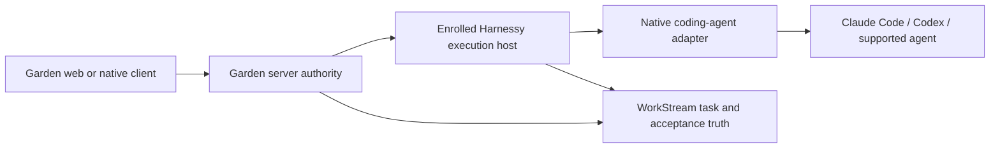

This is a contract proposal for the next shared contribution capability. This
change does not implement enrollment, remote launch, a wire transport or an agent
adapter. Harnessy owns the execution contract. Garden owns the client and server
integration described here. Review the contract in both repositories before
implementation. Do not infer an existing interoperable protocol from this page.

## Keep two interfaces separate

| Interface | Contract owner | Responsibility |
| --- | --- | --- |
| Garden to execution host | Harnessy execution contract; Garden integration | Enrollment, scoped launch, one run, status, intervention, cancellation and recovery |
| Host to coding agent | Harnessy host adapter | Translate the selected agent's supported CLI or protocol into the shared run contract |
| Contribution lifecycle | WorkStream | Task policy, submissions, evaluation, acceptance, contribution records and awards |
| Evidence export | Agreed Jarvis record format | Map existing evidence without changing acceptance or blocking payment |

An agent protocol such as Codex app-server can implement the second interface.
It does not supply Garden workspace authority or execution-host enrollment.
Use each agent's supported interface. Do not add another coding-agent loop.
Garden's existing Workflows remain the durable owner for existing managed runs;
an external host does not create a second recovery owner for those runs.

## Enrollment and transport

A workspace administrator enrolls a host with explicit workspace authority. The
host proves possession of a host key. Garden records the host ID, workspace,
operator identity, contract versions and permitted capability/runtime combinations.
The host operator registers repository aliases and allowed agents locally.
Enrollment grants no arbitrary path access and no unrestricted shell credential.

Use authenticated, encrypted transport. Prefer an outbound host connection so a
personal computer does not need a public listener. The concrete transport and
key-store implementation remain decisions for the implementation slice. Require
mutual endpoint authentication, key rotation, bounded replay windows and a durable
launch ledger before calling any transport qualified. Do not forward a browser
cookie to the host. Keep credentials in host storage; send scoped credential
references only when the host recognizes and authorizes them.

Host revocation blocks new dispatch immediately. The host must check fresh
run authority before each privileged operation. If it cannot refresh an expired
grant, it must stop new effects and report intervention required. Reconnection
does not restore revoked authority. Run cancellation and host revocation are
separate operations; define cleanup for each selected agent/runtime before release.

## Launch request and acknowledgement

The Garden server validates current membership, installation and permissions.
It then issues a scoped request. The host independently validates that request
against its enrollment and local policy. Plugin declarations never grant authority.
Task text is untrusted input and cannot replace validated launch fields.

| Field | Required meaning |
| --- | --- |
| `contractVersion` | Exact supported contract version; reject incompatible versions |
| `launchId` | Stable workspace-scoped request identity created before first dispatch |
| `requestDigest` | Digest of canonical validated launch inputs; retries must match |
| `workspaceId`, `memberId`, `operatorId`, `hostId` | Bound caller, operator and enrolled destination |
| `authority` | Signed or equivalently authenticated scoped grant, issuer, audience, expiry and revocation reference |
| `taskRef` | WorkStream instance, project, task and selected policy/revision references |
| `capabilityRef` | Installed package ID, exact version, digest and enforcement compatibility |
| `repositoryRef` | Host-registered repository alias and allowed base revision; never a client path |
| `agentRef` | Registered agent adapter and allowed model/provider choices |
| `budget` | Explicit coding-agent spend/resource limits and exhaustion behavior |
| `permissions` | Effective granted operations, credential references, network destinations and limits |
| `traceId` | Audit correlation only; never a substitute for launch identity |

The host atomically reserves `(workspaceId, launchId)` and its request digest
before creating a worktree or agent run. A repeated ID with the same digest
returns the same run. A repeated ID with a different digest fails with a conflict.
Persist the worktree and native agent/session mapping as resources are created.
Recovery must reconcile partial creation before starting another resource.
Exactly one isolated worktree and one agent run are allowed for an accepted
launch. Isolation must be an enforced runtime boundary, not ordinary in-process
plugin loading or a separate working directory alone.

An acknowledgement returns `launchId`, `requestDigest`, `runId`, accepted contract
version and current state. A lost acknowledgement means delivery is uncertain.
Garden queries by the original launch ID and retries with that same identity.
It must not invent a new launch ID because of a timeout. An offline host shows
unavailable/uncertain status. Dispatch after reconnect requires fresh authority;
it must not silently run an expired approval.

## Status, intervention and recovery

Use a host-owned durable event sequence per run. Each event includes the workspace,
host, run and launch IDs, monotonic sequence, time, event kind and safe payload.
Authenticate the source and authorize every read. Keep task text, plugin output
and model text out of control-message fields. Redact secrets before persistence.

| State or operation | Required behavior |
| --- | --- |
| Accepted / preparing / running | Show host receipt and resource creation separately from active agent work |
| Waiting for approval or input | Bind intervention ID, permitted response, expiry and current authority; notification receipt is not approval |
| Failed / cancelled / completed | Persist terminal state, reason and evidence references; completion is not WorkStream acceptance |
| Client disconnect | Leave execution policy unchanged; detach the client only |
| Cancel | Authorized, idempotent command with its own command ID; acknowledge receipt separately from confirmed termination |
| Reconnect | Fetch an authorized snapshot and events after the last cursor; repair gaps from the durable ledger |
| Conversation recovery | Recover the exact supported native conversation/session; history reading alone is not resume support |
| Missing or unsupported recovery | Report the limit and request intervention; never silently create a replacement run |

Host adapters map run/session/turn identities to each agent's native concepts.
Terminal detachment, cancellation, run continuation and exact conversation resume
are distinct. Preserve language, model, knowledge-provider and execution-host
choices when clients reconnect. A mobile client is a control surface; it is not
implicitly an on-device coding host and cannot promise unlimited background work.

## Package and evidence boundaries

The same contribution capability must work through standalone Harnessy and Garden
with host-rendered forms, actions and status cards. Outside executable packages
need exact version/digest pinning, static manifest/schema inspection without
executing discovery hooks, host compatibility checks and separate permissions.
An isolated discovery process is required if executable schema discovery cannot
be avoided. Credentials, networking, filesystem access and resource limits are
host-enforced during discovery and invocation. Installation controls must cover
activate, disable, update, rollback and uninstall, including running-job policy.
These are release gates for the plugin slice, not claims delivered here.

WorkStream remains authoritative for submission, evaluation and acceptance.
Repository review and merge follow project policy. A completed agent run, an open
PR, accepted work, earned points and actual payment are separate outcomes.
Proof records must bind the run, repository/revision, checks, review and artifact
references. Do not claim an effect succeeded before the host records the effect
receipt. Jarvis maps the resulting evidence; export never gates payment.

## Required conformance before direct launch release

Use common fixtures against standalone Harnessy and Garden. Include:

- Wrong tenant, host, member, repository alias, package digest or contract version.
- Expired/revoked grants, insufficient permissions and attempted credential/path escalation.
- Duplicate delivery, conflicting reuse of a launch ID, lost acknowledgement and partial worktree creation.
- Offline host, reconnect gaps, host restart and unsupported exact-conversation recovery.
- Cancellation during preparation, execution and intervention; distinguish command receipt from termination.
- Malicious package discovery and invocation, resource exhaustion, network denial and audit attribution.
- Disable, upgrade, rollback and uninstall, including dependency and running-job effects.
- One useful bounded real contribution, then separately its project acceptance and payment evidence where applicable.

A controlled fixture proves the named contract behavior only. Real contribution,
accepted record and paid contribution each need their own evidence. Native-client
support additionally requires physical-device and native lifecycle tests for each
claimed platform. The [client proposal](cross-platform-clients.md) owns those gates.
